# VPS2Fedora

> Seamlessly convert any existing Linux VPS (Debian, Ubuntu, CentOS, AlmaLinux, Rocky Linux, Arch Linux, etc.) into a freshly installed **Fedora 44** live in-place.
>
> Re-architected and optimized based on concepts from [vps2arch](https://github.com/drizzt/vps2arch) and [vps2fedora](https://github.com/U2FsdGVkX1/vps2fedora).

English | [中文文档](README_zh.md)

---

## Quick Start

### 1. Download and Run the Script

*(Note: The script automatically checks for and installs missing prerequisite tools such as `curl`, `tar`, `gzip`, and `iproute2` via your host's package manager).*

```bash
# Download the script
curl -fsSL -O https://github.com/ericclose/vps2fedora/raw/refs/heads/main/vps2fedora.sh
chmod +x vps2fedora.sh

# Run the re-imaging process (defaults to Fedora 44)
sudo ./vps2fedora.sh
```

For non-interactive / automated installations:
```bash
sudo ./vps2fedora.sh -y -r
```

### 2. Reboot the System

Once the script completes, it displays a summary of the network configuration and credentials:

- **If running in a `root` shell**:
  ```bash
  # Flush buffers and perform a hard reboot
  sync ; reboot -f
  ```
- **If running via a regular user (`sudo`)**: Wait a few seconds, then click **Reboot** in your VPS control panel (since the old system's `sudo` session and user database have been replaced, or pass `-r` when running the script to auto-reboot).

*(If the `-r` option is specified, the script automatically reboots after a 5-second countdown).*

### 3. Reconnect via SSH

After 1 to 3 minutes, connect to the VPS using the sudo user (`admin` by default, as Fedora disables direct `root` password login over SSH by default):

```bash
ssh admin@<your-vps-ip>
```

- **Default Credentials**: Both `admin` (in the `wheel`/sudo group) and `root` share the password `vps2fedora` by default (or customized via `-p <password>`). Run `sudo -i` after logging in to switch to `root`. No old configuration files or credentials from the previous system are retained.

---

## Command Line Options

```text
Usage: vps2fedora.sh [options]

Options:
  -v <version>       Fedora version to install (Default: 44)
  -m <mirror>        OCI registry mirror (Default: https://registry.fedoraproject.org)
  -u <user>          Sudo regular user to create (Default: admin)
  -p <password>      Password for root and sudo user (Default: vps2fedora)
  -n <network>       Network stack: NetworkManager or systemd-networkd (Default: NetworkManager)
  -d <disk>          Force bootloader target disk (e.g., /dev/vda, /dev/sda)
  -k <kernel>        Kernel package to install (Default: kernel)
  -r                 Automatically reboot the system after installation finishes
  -y                 Non-interactive mode (skip confirmation prompt)
  -t                 Dry-run / test mode (inspect network and storage without modifying system)
  -h                 Show this help message
```

### Examples

- **Convert to Fedora 44 with a custom root password**:
  ```bash
  sudo ./vps2fedora.sh -v 44 -p "MySecurePassword123"
  ```

- **Fully automated conversion using systemd-networkd**:
  ```bash
  sudo ./vps2fedora.sh -y -r -n systemd-networkd
  ```

---

## Architecture & Workflow

```mermaid
flowchart TD
    Host["Existing Linux Host (Debian / Ubuntu / CentOS / etc.)"] --> P1
    subgraph P1["Phase 1: Pre-flight & Information Gathering"]
        P1A["Extract IP/prefix, gateway, MAC, DNS, and hostname via ip addr & ip route"]
        P1B["Detect firmware (BIOS vs UEFI), disk devices, and partition UUIDs/fstypes"]
    end
    P1 --> P2
    subgraph P2["Phase 2: Bootstrap Extraction (OCI Rootfs)"]
        P2A["Download official Fedora 44 container layers from registry.fedoraproject.org"]
        P2B["Unpack layers into /fedora_bootstrap and locate internal ld-linux-*.so & chroot"]
    end
    P2 --> P3
    subgraph P3["Phase 3: Isolation Mounts & System Wipe"]
        P3A["Mount pseudo-filesystems and bind-mount / to /fedora_bootstrap/mnt"]
        P3B["Deep wipe: Delete all existing OS files from / (preserving /fedora_bootstrap)"]
    end
    P3 --> P4
    subgraph P4["Phase 4: DNF5 Package Installation"]
        P4A["Execute via bootstrap ld.so: dnf install --installroot=/mnt --releasever=44 @core kernel ..."]
    end
    P4 --> P5
    subgraph P5["Phase 5: Target Configuration"]
        P5A["Write NetworkManager keyfile (.nmconnection) & systemd-networkd profiles"]
        P5B["Set root password (default: vps2fedora), generate fresh /etc/fstab, enable sshd"]
        P5C["Install GRUB2 (BIOS/UEFI), generate /boot/grub2/grub.cfg, and build generic initramfs via dracut"]
        P5D["Offline SELinux xattr pre-labeling via setfiles + first-boot auto-enforcing service"]
    end
    P5 --> P6
    subgraph P6["Phase 6: Cleanup & Metadata Flush"]
        P6A["Unmount /mnt and /fedora_bootstrap; remove bootstrap directory"]
        P6B["Run fsfreeze on /boot and / to flush journal transactions, then sync & reboot -f"]
    end
```



---

## Frequently Asked Questions (FAQ)

### Q: Is ARM64 (aarch64) supported (e.g. Oracle Cloud Ampere)?
**A**: Yes. The script checks `uname -m`, maps the architecture to `aarch64` / `arm64`, and installs `grub2-efi-aa64` and `shim-aa64` for UEFI.

### Q: What is the SELinux status after rebooting into Fedora 44?
**A**: It boots directly into **Enforcing** mode out-of-the-box! No manual intervention is required—running `getenforce` immediately after SSH login will report `Enforcing`.

### Q: Why use `sync ; reboot -f` instead of normal `reboot`?
**A**: Normal `reboot` communicates with the init daemon (systemd), which is decoupled after the file wipe. `reboot -f` commands the Linux kernel to reset immediately, loading the newly installed Fedora 44 bootloader cleanly.

---

## License

This project is licensed under the [GNU General Public License v3.0 (GPL-3.0)](LICENSE).
Based on and acknowledging earlier work from [vps2arch](https://github.com/drizzt/vps2arch) and [vps2fedora](https://github.com/U2FsdGVkX1/vps2fedora).
