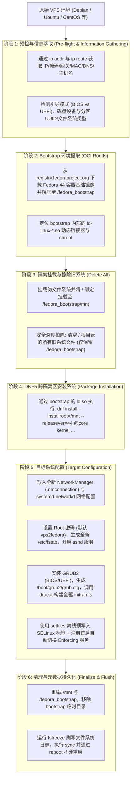

# VPS2Fedora

> 将任意现存的 Linux VPS（Debian、Ubuntu、CentOS、AlmaLinux、Rocky Linux、Arch Linux 等）在线平滑重装转化为 **Fedora 44**。
>
> 借鉴并重构优化自 [vps2arch](https://github.com/drizzt/vps2arch) 与 [vps2fedora](https://github.com/U2FsdGVkX1/vps2fedora)。

[English Documentation](README.md) | 中文文档

---

## 快速开始

### 1. 下载并运行脚本

*(注：脚本内置了依赖自检与自动安装机制，若宿主机缺失 `curl`、`tar`、`gzip` 或 `iproute2`，会自动调用宿主包管理器补齐)*。

```bash
# 下载脚本
curl -fsSL -O https://github.com/ericclose/vps2fedora/raw/refs/heads/main/vps2fedora.sh
chmod +x vps2fedora.sh

# 运行脚本（默认转化为 Fedora 44）
sudo ./vps2fedora.sh
```

如果你希望静默执行（非交互自动化模式）：

```bash
sudo ./vps2fedora.sh -y -r
```

### 2. 重启完成转化

脚本执行完毕后，会打印完整的网络配置和登录凭据摘要：

```bash
# 刷新磁盘缓存并强制硬重启
sync ; reboot -f
```

*如果指定了 `-r` 参数，脚本将在完成时自动进行倒计时硬重启。*

### 3. 重新连接 VPS

等待 1～3 分钟后，使用默认创建的 `wheel` 管理员用户 `admin` 通过 SSH 重新连接（Fedora 默认禁止 `root` 直接使用密码通过 SSH 登录）：

```bash
ssh admin@<你的VPS-IP>
```

- **默认密码**：`admin`（具备 `sudo` 权限）与 `root` 的密码默认均设置为 `vps2fedora`（或通过 `-p <password>` 指定自定义密码），登录后可执行 `sudo -i` 切换至 `root`，不保留原系统的任何旧配置或文件。

---

## 命令行参数选项

```text
Usage: vps2fedora.sh [options]

Options:
  -v <version>       Fedora 版本号 (默认: 44)
  -m <mirror>        OCI 容器镜像源地址 (默认: https://registry.fedoraproject.org)
  -u <user>          创建的普通管理员用户名 (默认: admin)
  -p <password>      指定 root 与管理员用户的密码 (默认: vps2fedora)
  -n <network>       网络管理组件: NetworkManager 或 systemd-networkd (默认: NetworkManager)
  -d <disk>          指定 BIOS 引导安装的磁盘设备 (如 /dev/vda, /dev/sda, 默认自动识别)
  -k <kernel>        安装的内核包名称 (默认: kernel)
  -r                 安装完成后自动执行倒计时重启
  -y                 免交互模式 (不弹出二次确认提示)
  -t                 预检演练模式 (仅探测网络与存储配置，不修改或擦除系统)
  -h                 显示帮助信息
```

### 使用示例

- **转化为 Fedora 44 并自定义 Root 密码**：
  ```bash
  sudo ./vps2fedora.sh -v 44 -p "MyStrongPass123"
  ```

- **全自动免交互且使用 systemd-networkd**：
  ```bash
  sudo ./vps2fedora.sh -y -r -n systemd-networkd
  ```

---

## 系统架构与运行原理



---

## 常见问题与解答 (FAQ)

### Q: 是否支持 ARM64 (aarch64) 架构的 VPS（如 Oracle Cloud Ampere）？
**A**: 完全支持。脚本在初始化时会检测 `uname -m`，自动映射为 `aarch64` / `arm64` 镜像层，并在 UEFI 环境下安装 `grub2-efi-aa64` 和 `shim-aa64`。

### Q: 重装后 SELinux 的运行状态是什么？
**A**: 无需手动干预，开机即是 **Enforcing** 模式！脚本在安装期离线预置标签，并在首次启动时通过自毁服务完成根目录与动态库补标后自动切换为 Enforcing，登录后执行 `getenforce` 即可看到状态为 `Enforcing`。

### Q: 为什么推荐使用 `sync ; reboot -f` 而不是直接 `reboot`？
**A**: 由于原系统的 init 守护进程（如旧 systemd）在文件擦除后已经脱节，常规优雅重启会试图与已经失效的 DBus 通信从而发生卡死。`reboot -f` 直接通知 Linux 内核发起硬重启，结合脚本前置的 `fsfreeze` 和 `sync`，可以干净无误地直接进入新安装的 Fedora 44。

---

## 开源协议

本项目采用 [GNU General Public License v3.0 (GPL-3.0)](LICENSE) 授权。
基于并感谢 [vps2arch](https://github.com/drizzt/vps2arch) 与 [vps2fedora](https://github.com/U2FsdGVkX1/vps2fedora) 项目的先驱工作。
